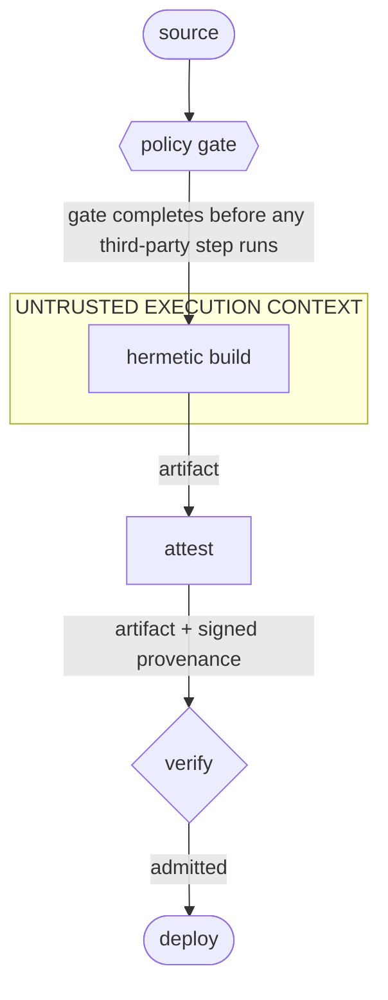
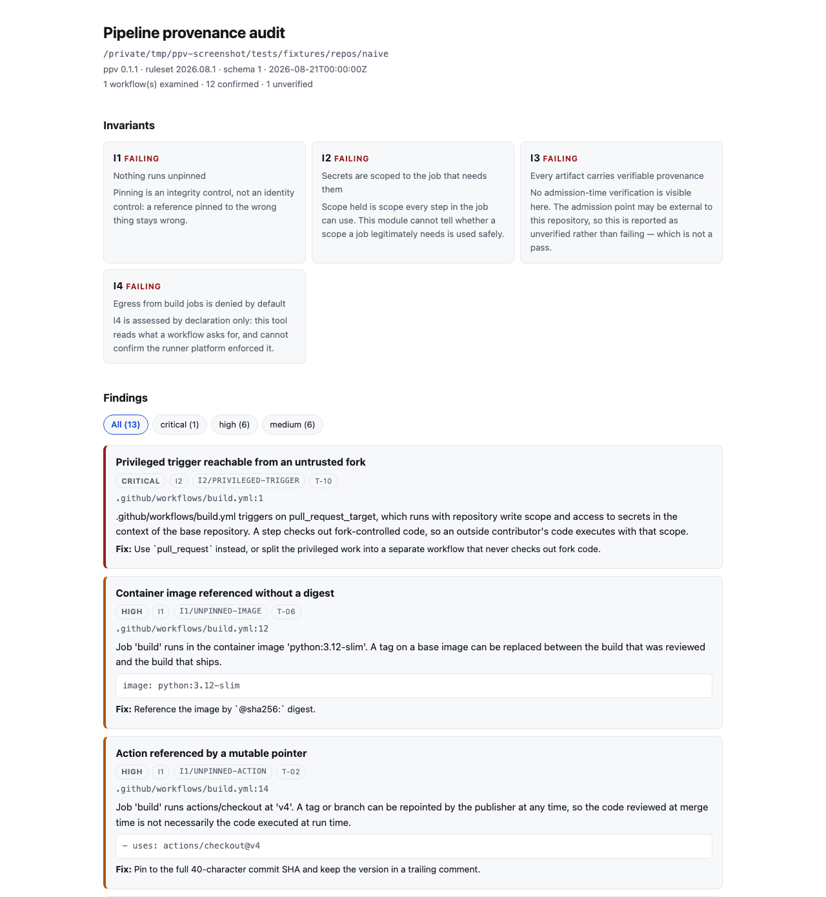

# Pipeline Provenance

**Supply-chain hardening for CI/CD: four structural invariants, signed
provenance, admission-time verification, and a demonstrated compromise.**

[](https://github.com/tomdgImpact/Pipeline-Provenance/actions/workflows/ci.yml)
[](LICENSE)

> **Status: v0.1.1.** All five phases of [`ROADMAP.md`](ROADMAP.md) have landed:
> the audit CLI, the hardened reusable workflow, admission-time verification,
> the three-act demonstration, and the measurements below. Every figure quoted
> here carries the corpus, the method and the date it was measured on, and the
> raw output is committed under
> [`benchmarks/published/`](benchmarks/published/).

---

## Quickstart

Python 3.12+ and [uv](https://docs.astral.sh/uv/). Nothing else — no account, no
API key, no service.

```bash
git clone https://github.com/tomdgImpact/Pipeline-Provenance
cd Pipeline-Provenance
uv tool install .

ppv audit /path/to/your/repository
```

What that prints, against a repository that pinned its actions and stopped there:

```text
  [FAIL] I1  Nothing runs unpinned
  [FAIL] I2  Secrets are scoped to the job that needs them
  [FAIL] I3  Every artifact carries verifiable provenance
  [FAIL] I4  Egress from build jobs is denied by default

6 finding(s):

  HIGH     I3/no-provenance
           .github/workflows/build.yml:10
           Artifact produced without provenance
           > build:
           fix: Emit an in-toto SLSA provenance statement for the artifact and sign it under the workflow identity.

  MEDIUM   I2/excessive-permission
           .github/workflows/build.yml:13
           Job holds repository write scope
           > permissions:
           fix: Move the step that needs write into its own job, or drop the scope. Keep `id-token`/`attestations` for signing only.

  ... 4 more findings, most severe first
```

`ppv audit . --format html -o report.html` produces the same result as one
self-contained file that renders with the network disabled. `--format sarif`
sends it to code scanning. `ppv gate .` turns it into a blocking CI check.

Full instructions, prerequisites and troubleshooting:
**[`docs/INSTALL.md`](docs/INSTALL.md)**.

---

## The thesis

The build pipeline is the largest unaudited attack surface in most
organisations. It holds production credentials, it executes third-party code on
every push, and its output is trusted by definition — nothing downstream
re-examines an artifact that arrived from "our own CI".

A compromised third-party action, a typosquatted dependency, or a mutable tag on
a container base image gives an attacker signed, trusted, production-bound
artifacts **without ever touching production**. That is a shorter path than
attacking production directly, and it is defended far less.

The fear worth naming:

> **A third-party GitHub Action you pinned to a tag can read every secret in
> that job.**

Not because the action is malicious today. Because a tag is a mutable pointer,
and the code reviewed on Tuesday is not necessarily the code executed on
Thursday.

## Who the adversary is

Three adversaries, in increasing order of capability. None has production
access. All three reach production *through* the pipeline.

| | Adversary | What they need |
|---|---|---|
| **ADV-1** | Public dependency author | Register a name, publish a version |
| **ADV-2** | Third-party action author, or whoever compromises one | One maintainer account |
| **ADV-3** | Contributor with push access to a non-protected branch | One compromised contributor |

Explicitly **out of scope**: a compromised runner host, a compromised CI
platform, a malicious repository administrator. Every guarantee below assumes
those hold. Full statement in [`docs/THREAT_MODEL.md`](docs/THREAT_MODEL.md).

## The four invariants

Each is enforced by a check, at a named point, not recommended in a style guide.

| | Invariant | Enforced at | Structural? |
|---|---|---|---|
| **I1** | **Nothing runs unpinned.** Actions pinned to commit SHAs, dependencies pinned with hashes, base images pinned by digest. | Policy gate, before any third-party step runs | Yes — an unpinned reference does not build |
| **I2** | **Secrets are scoped to the job that needs them** and unreadable by third-party steps. Explicit `permissions:`, OIDC over static keys. | Policy gate | Yes |
| **I3** | **Every artifact carries verifiable provenance, and deployment verifies it.** | Admission point, outside the build's blast radius | Yes — nothing deploys without passing it |
| **I4** | **Egress from build jobs is denied by default.** A build that suddenly talks to a new host fails rather than succeeding quietly. | Build job network policy | Yes where the runner supports it; **reported as unenforceable where it does not** |

The load-bearing design claim: **the build job is an untrusted execution
context.** Controls are placed *before* it runs, on *what it may produce*, and
at *what production accepts* — never inside it, where an attacker who already
has code execution could disable them.

## Architecture



- **policy gate** — pinning check, permissions lint, egress policy. Runs to
  completion before any third-party step.
- **hermetic build** — no ambient credentials, allowlisted egress. This is the
  untrusted execution context: assume arbitrary code runs here.
- **attest** — SLSA provenance + CycloneDX SBOM, cosign keyless signature bound
  to workflow identity.
- **verify** — admission-time: signature, provenance predicate, expected signer
  identity, SBOM policy.

## What ships

- **A reusable, opinionated workflow** implementing all four invariants,
  installable into an existing repository with a documented migration path.
- **An audit CLI (`ppv`)** that scores an existing repository against the same
  four invariants and emits JSON, SARIF and a self-contained HTML report. It
  detects I1–I4 — not "supply-chain risk" in general — and says so.
- **The demonstration:** a deliberately malicious third-party action in a
  sandbox repository that exfiltrates the job token, running successfully
  against a naive pipeline and provably failing against the hardened one.
  Reproducible, and a blocking CI step.
- **A threat model** with trust boundaries, a fourteen-row attack table, and
  accepted residual risk stated in full.

<picture>
  <source media="(prefers-color-scheme: dark)" srcset="docs/assets/report-dark.png">
  <source media="(prefers-color-scheme: light)" srcset="docs/assets/report-light.png">
  
</picture>

*`ppv audit --format html` over [`tests/fixtures/repos/naive`](tests/fixtures/repos/naive),
top of the report. One file, no external references: it renders with the network
disabled. Regenerate it with
[`docs/assets/generate_screenshots.py`](docs/assets/generate_screenshots.py).*

## Adversarial proof

### The demonstration, in three acts

| | Pipeline | Outcome | Blocked by |
|---|---|---|---|
| 1 | Naive | Token reaches the collector | nothing |
| 2 | Hardened | Action never executes | policy gate — unpinned reference (I1) |
| 3 | Hardened, action pinned **and** allowlisted | Executes, reaches nothing | egress deny (I4), scoped token (I2), artifact refused at admission (I3) |

Act 1 asserts the attack **succeeds**. That half is not decoration: a
demonstration asserting only the hardened outcome passes just as happily when
the attack never worked in the first place. Act 3 is the one worth reading — it
hands the attacker everything the gate would have taken away and the remaining
three invariants still hold, separately asserted.

The CI job closes the gap a local run cannot: behind a default-deny egress
policy it reaches for an unlisted host and **fails the build if the request
succeeds**. A control that is declared and not in force reads as a control.

The payload moves `DEMO_FAKE_TOKEN`, never a real credential — see
[`demo/README.md`](demo/README.md) for why that substitution is deliberate.

### The corpus

The attack table in the threat model is not prose: every row is a test in
`tests/security/`, and that suite runs as **its own blocking CI step**. The step
fails if the suite collects zero tests or skips one — see
[`scripts/assert_suite_ran.py`](scripts/assert_suite_ran.py). A corpus that can
silently degrade to nothing is not a control, and a green tick over an empty
selection is worse than no tick at all.

The corpus already asserts this repository satisfies the invariants it sells:
every action pinned to a commit SHA, top-level permissions empty, least
privilege per job, no `pull_request_target`, no persisted checkout credentials.
A pipeline-hardening project whose own pipeline is unpinned is an argument
against itself.

## Measured results

Every number below is reproducible from a clean checkout. The raw harness output
is committed in [`benchmarks/published/`](benchmarks/published/), dated and
stamped with the ruleset version that produced it.

### Detection quality — ruleset 2026.08.1, measured 2026-08-21

| | Value |
|---|---|
| Corpus | 6 hand-curated fixture repositories, 30 declared defects |
| Precision | **1.0** |
| Recall | **1.0** |
| False positives on the 2 clean fixtures | **0** |

**The caveat is the credential.** The denominator is the defect table in each
fixture's `intent.md`, hand-written *before* the rule that detects it. Measuring
against the tool's own saved output would establish only that the tool agrees
with itself, which is the failure mode most detection benchmarks quietly have.
The corpus is small and synthetic by construction: these figures describe six
repositories and say nothing about the long tail of real-world workflows.

```bash
python -m benchmarks.detection
```

### What the invariants look like in the wild — measured 2026-08-20

Fourteen widely-used open-source projects across several ecosystems, 101
workflow files. **Aggregate only — no individual project is named**, and a test
enforces that. The sample list is committed in `benchmarks/corpus.txt` so nobody
has to take the aggregate on trust.

| Invariant | Passing | Failing |
|---|---|---|
| **I1** nothing runs unpinned | 0 / 14 | **14 / 14** |
| **I2** secrets scoped to the job | 0 / 14 | **14 / 14** |
| **I3** verifiable provenance | 4 / 14 | **10 / 14** |
| **I4** egress denied by default | 0 / 14 | **14 / 14** |

Most frequent findings — note that *findings* and *repositories affected* answer
different questions and are reported separately:

| Rule | Findings | Repositories |
|---|---|---|
| `I1/missing-version-comment` | 341 | 9 / 14 |
| `I4/no-egress-policy` | 221 | 14 / 14 |
| `I2/implicit-token-scope` | 86 | 12 / 14 |
| `I2/persisted-credentials` | 58 | 10 / 14 |
| `I1/unpinned-action` | 58 | 5 / 14 |
| `I3/no-sbom` | 48 | 10 / 14 |
| `I3/no-provenance` | 41 | 10 / 14 |
| `I2/privileged-trigger` | 9 | 3 / 14 |

**Caveats.** The sample is small and deliberately chosen, not random: it
describes these fourteen projects and is not a population estimate. Only
`.github/workflows` was read; reusable workflows called from other repositories
were not followed. I4 is assessed by declaration — no runner was observed.

```bash
python -m benchmarks.distribution --online --output out.json
```

### Audit performance — measured 2026-08-21

Median wall clock, 20 repetitions, offline, on `macOS-26.6.1-arm64-arm-64bit` /
CPython 3.12.13:

| Target | Workflows | Median | p95 |
|---|---|---|---|
| This repository | 3 | **115.92 ms** | 148.46 ms |
| `monorepo` fixture | 3 | 13.99 ms | 17.17 ms |
| `naive` fixture | 1 | 5.13 ms | 7.54 ms |

Against a 5 s budget (SC-008). One developer machine, named above — not a
portable figure and not a claim about any other hardware. A monorepo with
hundreds of workflows was not measured, and the record does not support
extrapolating past three workflow files.

```bash
python -m benchmarks.performance
```

### The tool against itself

`ppv audit .` reports **one confirmed finding** against this repository —
`I2/excessive-permission` on the SAST job, which needs `security-events: write`
to upload SARIF. The rule is right that write scope has to be argued for; the
argument is in [`docs/THREAT_MODEL.md`](docs/THREAT_MODEL.md) §9, and a test
fails both if a new unaccepted finding appears **and** if this one is fixed
without removing it from the list. An accepted-risk register that only grows is
a suppression file with better manners.

I3 reports `unverified` here, correctly: this repository ships a build workflow
and a library, and the admission point belongs to whoever consumes them. That is
not a pass.

Running the tool against its own pipeline found eight jobs with unrestricted
egress and one artifact-detection false positive. Both were real, and both were
fixed — the commits are in the history.

## Limitations

Read this section before the rest.

1. **Provenance proves where an artifact came from, never that it is correct.**
   A signed attestation for a backdoored artifact is a valid attestation.
2. **A dangerous tool that is legitimately allowlisted is still dangerous.** The
   policy gate constrains *which* code runs, not what permitted code can do.
3. **No defence against a compromised runner host or CI platform.** If the
   runner does not execute what it was given, or the platform issues dishonest
   OIDC tokens, none of these controls hold. No configuration changes that.
4. **No defence against a malicious repository administrator**, who can remove
   the required status check that makes the policy gate structural.
5. **Pinning is an integrity control, not an identity control.** A typosquatted
   package pinned on day one is faithfully preserved. See threat model T-03/T-04.
6. **Allowlisted egress is still a channel.** An attacker who can reach an
   allowlisted host can exfiltrate through it. The control raises cost; it does
   not close the category.
7. **Reproducible builds are claimed only where actually achieved**, per language
   ecosystem, and never inferred from hermeticity. See
   [ADR-0005](docs/adr/0005-reproducibility-claim.md).
8. **Self-hosted runner hardening is documented, not enforced.** The audit tool
   reports on it; it cannot remediate it.
9. **The audit tool detects the four invariants above.** A repository that
   scores well is not "secure"; it satisfies four named invariants.
10. **No third-party review.** The threat model and the corpus are the author's.

## Documentation

| Document | What it holds |
|---|---|
| [`docs/INSTALL.md`](docs/INSTALL.md) | Prerequisites, the three install paths, verification, troubleshooting |
| [`docs/THREAT_MODEL.md`](docs/THREAT_MODEL.md) | Trust boundaries, STRIDE, the attack table, accepted residual risk |
| [`docs/ADOPTION_COST.md`](docs/ADOPTION_COST.md) | What each invariant costs to adopt, what it retires, and when not to adopt it |
| [`docs/COMPLIANCE_MAPPING.md`](docs/COMPLIANCE_MAPPING.md) | SLSA, SSDF, CRA, NIS2 and DORA — what the invariants evidence, what they do not, and why a passing control is not compliance |
| [`docs/ENGINEERING_PRINCIPLES.md`](docs/ENGINEERING_PRINCIPLES.md) | The rules a change is reviewed against |
| [`docs/adr/`](docs/adr/) | Why digest pinning, keyless signing, admission-time verification, and what reproducibility is not |
| [`specs/001-pipeline-provenance/`](specs/001-pipeline-provenance/) | Specification, plan and task graph for v0.1.0 |
| [`CONTRIBUTING.md`](CONTRIBUTING.md) | Delivery model, branch policy, definition of done |
| [`SECURITY.md`](SECURITY.md) | Disclosure policy, and what is explicitly not a vulnerability here |
| [`ROADMAP.md`](ROADMAP.md) | Phases with exit criteria |

## Local development

See [`docs/INSTALL.md`](docs/INSTALL.md) for prerequisites.

```bash
make install        # project plus development dependencies
make check          # everything CI blocks on
make test-security  # the adversarial corpus, on its own
make demo           # the three acts
make bench          # every published figure, measured offline
ppv doctor          # what this installation can and cannot verify
```

Auditing something:

```bash
ppv audit .                          # human-readable, offline
ppv audit . --format html -o r.html  # one self-contained file, no network
ppv audit . --format sarif -o r.sarif
ppv gate .                           # fail the build on any violation
ppv gate . --invariant I1            # ...or only on the ones you have adopted
ppv verify dist/app.whl --provenance p.json --sbom s.json
```

`ppv doctor` names every capability it does **not** have. A tool that silently
degrades into a permissive mode is worse than one that refuses.

## Licence

Apache-2.0. The patent grant matters for tooling adopted inside other
organisations' build systems.
